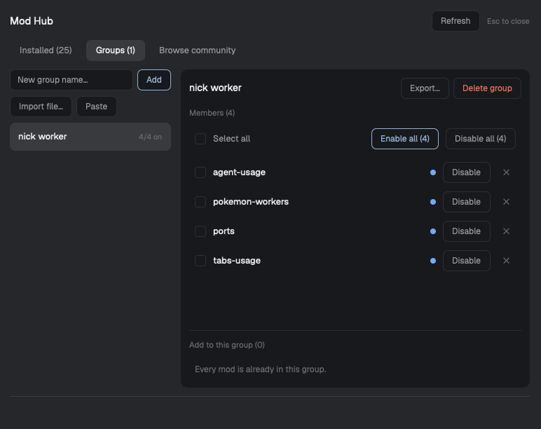

# herdr-mod-hub

**Mod Hub: switch Herdr mods on and off in groups, from one panel.**



Herdr has no built-in place to see and manage your mods. Mod Hub is that place. Make a group such as
"writing" or "agents", put mods in it, and turn the whole group on or off with one click. Share a group
with someone as a small JSON file.

## What it does

- **Groups.** Create groups, add mods, then Enable all or Disable all for one group.
  Each member has its own Disable/Enable button, and a Select all checkbox works on the ticked ones.
- **Enable, disable, remove.** Disabling returns Herdr to how it was before the mod: the mod stops loading.
  Removing is reversible: the mod goes to a holding area, where you can restore it or delete it for good.
- **Right-click menu** (or the `⋯` button) on any row: enable/disable, add to a group, reload, remove.
- **Export and import groups** as JSON. Import by pasting, or (macOS) by choosing a file.
  The preview shows what will be added, how many entries were skipped, and a "Get prompt" button for every
  mod you do not have yet.
- **Browse community mods** and copy the same "add this mod" prompt herdr.dev gives you.
  **Mod Hub never downloads or installs anything.** You paste the prompt to your agent, which reads every
  file before adding it.
- **Warnings** before you disable a mod that a layout or another mod uses.

## Install

When this repo is listed on herdr.dev/mods, use the "add this mod" prompt on its page.

By hand: create `~/.config/herdr-app/mods/mod-hub/`, copy `mods/mod-hub/main.js` and `mods/mod-hub/mod.json`
into it. Read `main.js` first; it is the only code. Herdr loads it on save.

Open it with `herdr-app do mod.open --name mod-hub`, or bind a key. `mods/mod-hub/keys.json` has an example
(`cmd-shift-m`).

## Is it safe to let it move my files?

It only moves, creates or deletes things in three places: `~/.config/herdr-app/mods/`,
`~/.config/herdr-app/data/mod-hub/`, and the folder you pick for an export.

| Action | What it does to your files |
|---|---|
| Disable / Enable | Moves the folder between `mods/<name>` and `data/mod-hub/disabled/<name>`. Never overwrites; if the destination exists it does nothing. |
| Remove | Moves it to `data/mod-hub/removed/<name>__<time>`. Nothing is deleted. |
| Delete permanently | `rm -rf` only on an entry inside `data/mod-hub/removed/` named `<name>__<digits>`. Asked twice. |
| Export | Writes one **new** file in the folder you pick. Never overwrites, never writes through a symlink. |
| Reload | `touch` on an existing `main.js` of an enabled mod so Herdr re-reads it. Never creates a file. |
| Browse | One read-only request to `https://assets.herdr.dev/mods/index.json`. Nothing else uses the network. |
| Clipboard and links | Herdr's own API. No shell command. |

Protections: a mod name must match `^(?!\.)[A-Za-z0-9._-]+$` (no `.`, `..`, `/`, spaces or quotes) and must
exist; names reach the shell as arguments, never inside a command line; Herdr's built-in mods and Mod Hub
itself can never be disabled or removed; imported groups and a hand-edited `state.json` are cleaned the same
way. Folders with odd names are listed as "unsupported name" with no action buttons.

Your groups live in `~/.config/herdr-app/data/mod-hub/state.json`. A malformed file is copied to
`state.json.corrupt-<time>` before anything is overwritten.

## Platforms

- Everywhere: list, enable, disable, remove, restore, groups, export, Paste import, browse.
- macOS only: **Import file…** (uses `osascript`) and **Reveal in Finder**. Elsewhere they are hidden; use Paste.
- Developed and tested on macOS with Herdr 0.1.13. Linux, Windows and other Herdr versions are untested.

## Optional: hide a disabled mod's toolbar button

Disabling a mod stops it from loading, but a button that *another* mod draws for it can stay. Mod Hub
publishes the disabled names under the shared key `modhub.disabled`. A mod can read it and hide its own button:

```js
.when(!(shared("modhub.disabled") ?? []).includes("ports"), el => el.child(portsButton))
```

Only mods that do this react. Others are unaffected.

## Tests

```
node tests/safety-harness.mjs
```

Runs the real `main.js` against a throw-away sandbox with hostile folder names (`$(touch PWNED)`, quotes,
newlines, `..`, symlinks pointing outside), hostile state files, imports and catalog data, using real shell
commands, then diffs the whole sandbox. It checks that nothing outside the three places above changed, that
decoy files stayed byte-identical, and that no unexpected command ran. It does not test the visual UI, and it
replaces `osascript`, `open` and the Herdr APIs with stubs. Tested with Node 24. It never touches your real
`~/.config`.

## Limits

- Mods are trusted code in Herdr. This tool does not sandbox them. Read a mod before you enable it.
- Reloading a symlinked mod updates the modification time of the file it points to (content unchanged).
- Two Mod Hubs open at once are not coordinated; the later write is rejected and re-read.

## License

MIT, see `LICENSE`.
